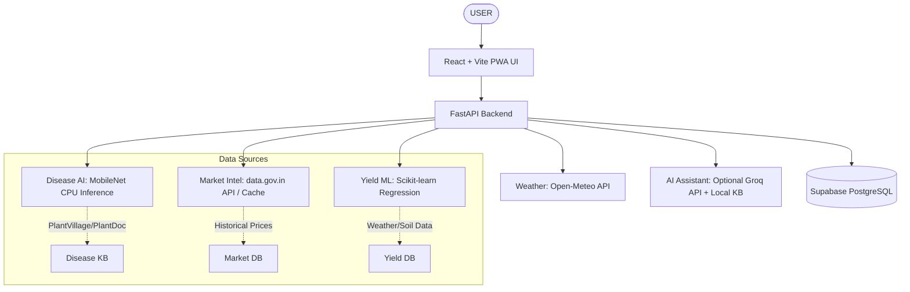

> Current account access: the public web, Windows and Android interfaces are account-free. User login/logout/signup and private history screens have been removed; the database/auth sections below describe the original proposal. Existing stored data and owner-only policies are preserved. See [current status](authentication.md).

# AGROVISION AI - Architecture Document

## System Overview
AgroVision AI is an integrated, AI-powered precision agriculture platform that provides disease detection, yield prediction, and market intelligence to farmers through a unified interface.

## Target Environment Constraints
* **Client:** Responsive web app (mobile and desktop) with PWA capabilities for offline fallback.
* **Server:** Windows 10, Intel Core i5 1st Gen, 8GB RAM, CPU-only.
* **Inference:** Lightweight CPU-based execution (e.g., MobileNet/TFLite, Scikit-learn). Heavy models (YOLO, massive LLMs) are strictly avoided to accommodate hardware limitations.

## High-Level Architecture Diagram

## Module Breakdown

### 1. Frontend (React + Vite)
*   **Role:** User Interface and offline PWA shell.
*   **Technologies:** React, Vite, CSS (Premium AgriTech styling: Dark green, cream, gold), IndexedDB for local cache.
*   **Offline Mode:** Service workers handle caching of app shell, disease library, and previously fetched API responses.

### 2. Backend API (FastAPI)
*   **Role:** Orchestrator and REST API provider.
*   **Technologies:** Python 3.11+, FastAPI, Pydantic, SQLAlchemy.
*   **Structure:** Modular routes (`/api/v1/disease`, `/api/v1/yield`, etc.).
*   **Error Handling:** Graceful degradation. If an external API fails, the backend returns a structured error or cached data, rather than crashing or returning fake data.

### 3. Crop Disease AI (Computer Vision)
*   **Model:** MobileNetV2 or V3 (optimized for CPU).
*   **Process:** Image upload -> Validation -> Normalization -> CPU Inference -> Threshold check.
*   **Unknown Detection:** If confidence < threshold (e.g., 0.70), return "Unable to confidently identify this disease."
*   **Knowledge Base:** Local static database with disease details, natural management, and IPM.

### 4. Yield Prediction (Machine Learning)
*   **Model:** Scikit-learn Regression (e.g., Random Forest or Ridge Regression).
*   **Inputs:** Crop, state, district, season, area, weather features.
*   **Output:** Predicted yield (with MAE/RMSE evaluated).

### 5. Market Intelligence & Weather
*   **Market Data:** Fetched from data.gov.in / AGMARKNET API (or local cache).
*   **Weather Data:** Fetched from Open-Meteo API.
*   **Analytics:** Simple trend calculations (moving averages, max/min prices).

### 6. Database & Authentication (Supabase)
*   **Database:** PostgreSQL for user profiles, prediction history, and cached data.
*   **Auth:** JWT-based authentication for farmers, researchers, and admins.
*   **Storage:** Secure bucket for uploaded images (if user opts in).

## Project Evolution Strategy
1.  **Mini Project:** Complete core API functionality, simple UI, basic CNN disease classifier, linear yield model, live market API, and Supabase integration.
2.  **Main Project:** Introduce Explainable AI (Grad-CAM), disease severity, Voice synthesis, advanced RAG LLM integration, offline-first PWA optimizations, and full model evaluations.
